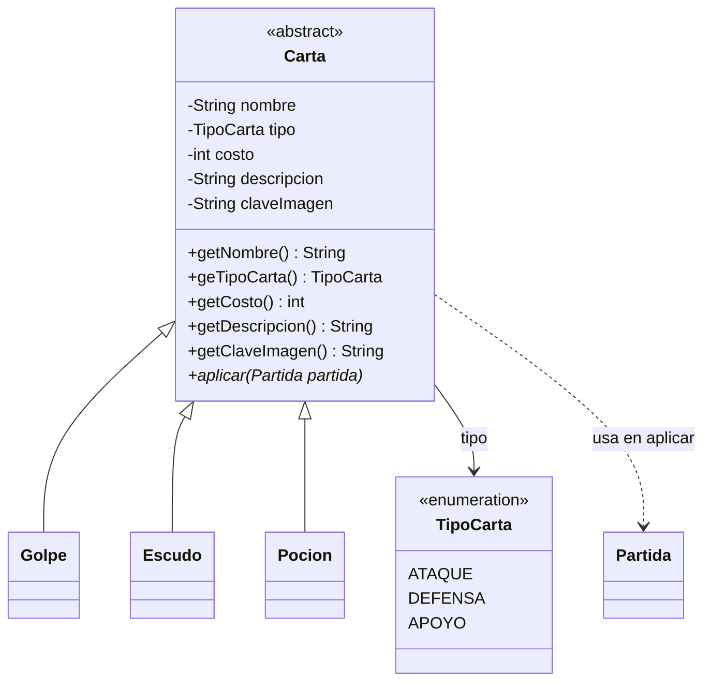

# Diagramas UML

## 1. Cartas

Muestra la herencia: `Carta` es abstracta y `Golpe`, `Escudo` y `Pocion` la extienden. Cada carta implementa `aplicar` a su manera (polimorfismo). `Carta` guarda su `TipoCarta` y usa `Partida` solo como parámetro.