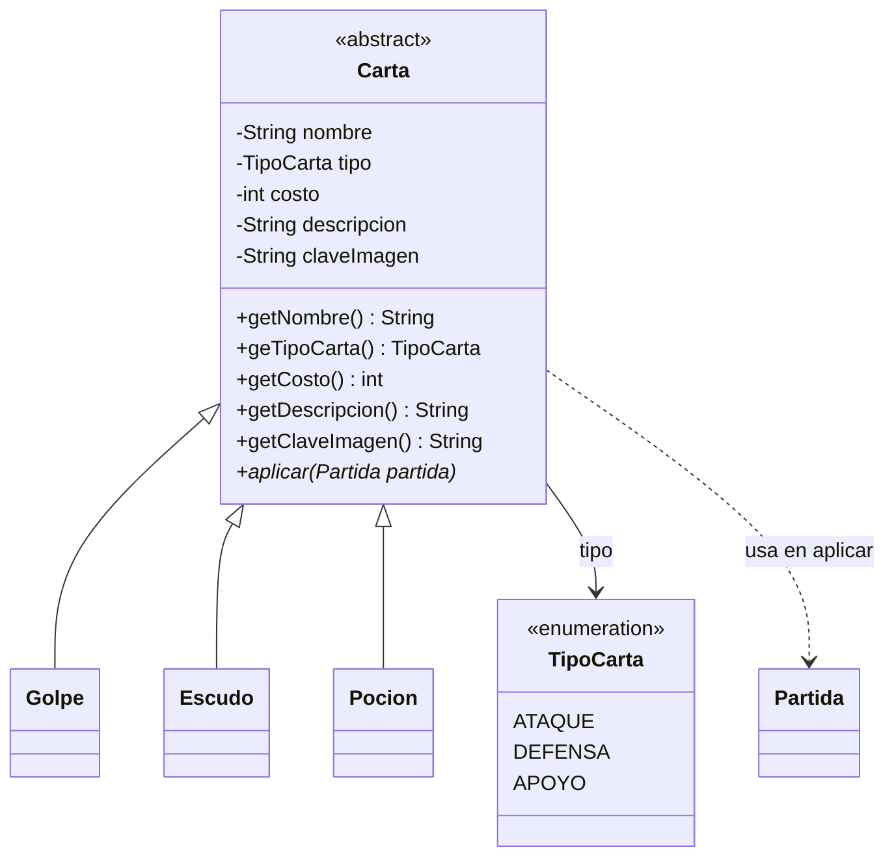
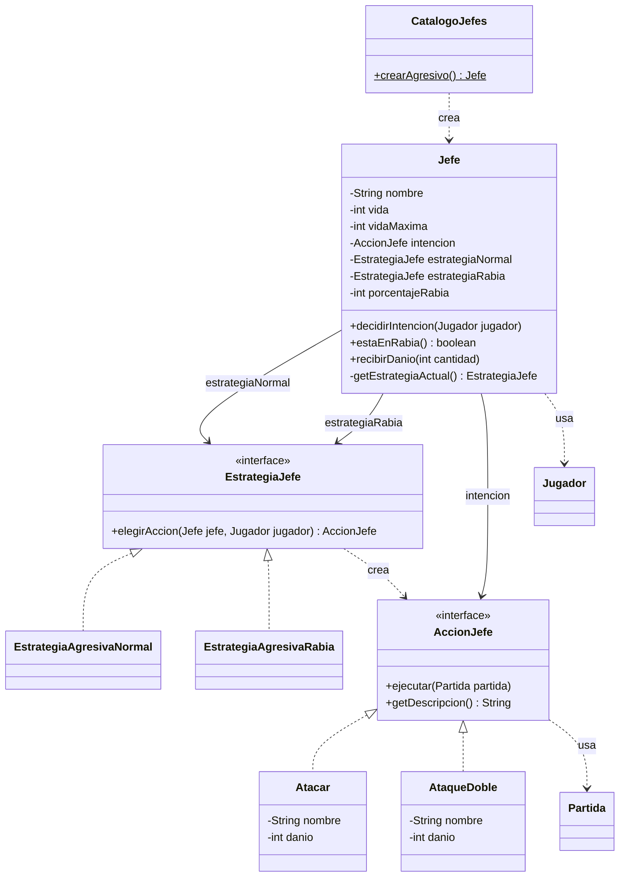

# Diagramas UML

## 1. Cartas

Muestra la herencia: `Carta` es abstracta y `Golpe`, `Escudo` y `Pocion` la extienden. Cada carta implementa `aplicar` a su manera (polimorfismo). `Carta` guarda su `TipoCarta` y usa `Partida` solo como parámetro.

## 2. Strategy (jefes)

Roles: `Jefe` es el contexto, `EstrategiaJefe` la estrategia y `EstrategiaAgresivaNormal` y `EstrategiaAgresivaRabia` las estrategias concretas. `Jefe` elige una según su vida (`estaEnRabia`) y le delega la decisión, así que no tiene `if` por tipo de jefe. Cada estrategia devuelve una `AccionJefe`.